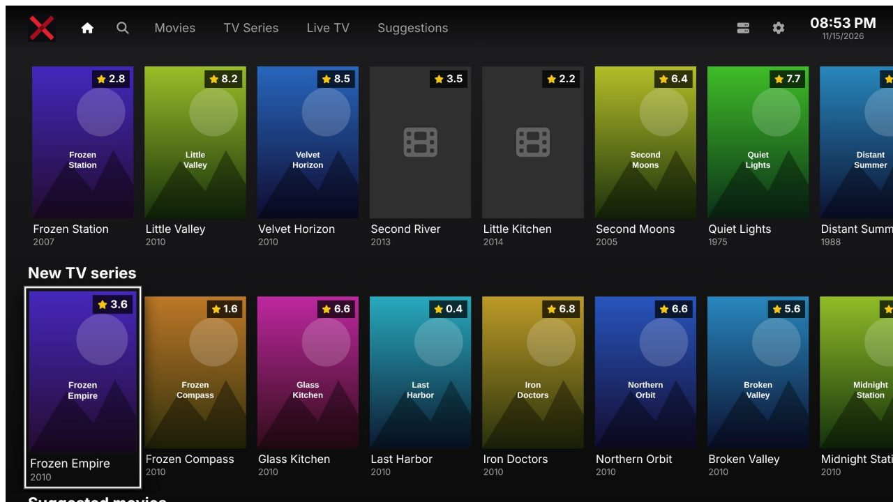
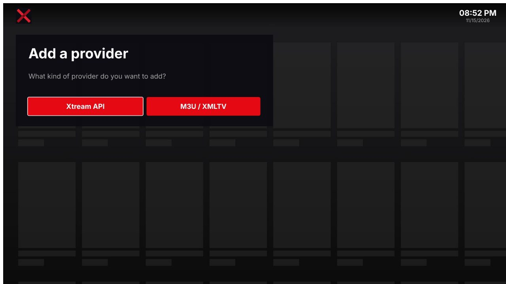
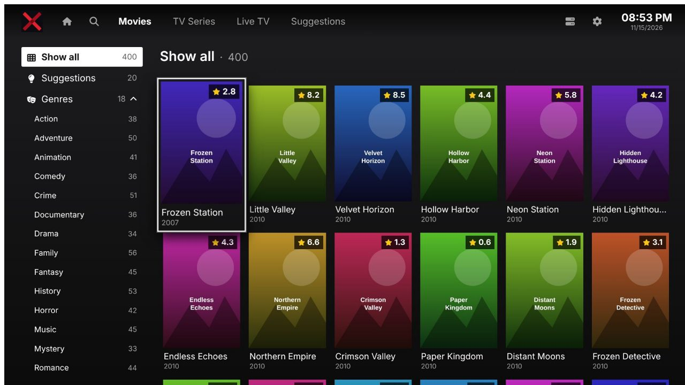
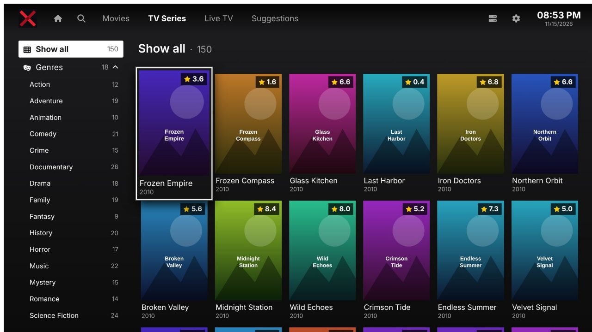
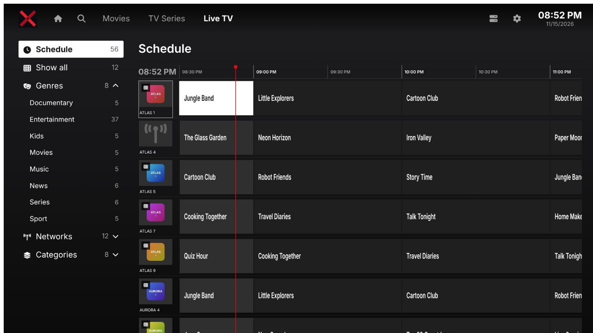
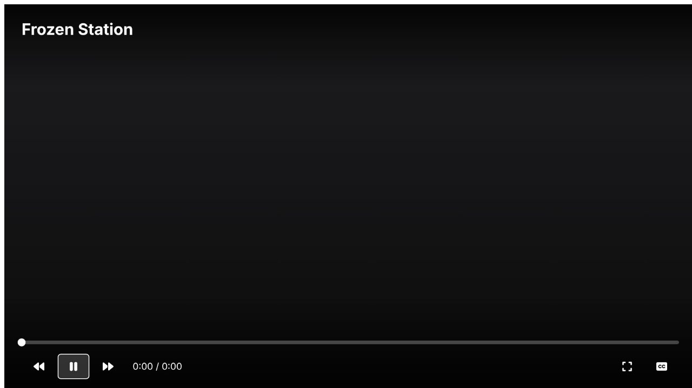
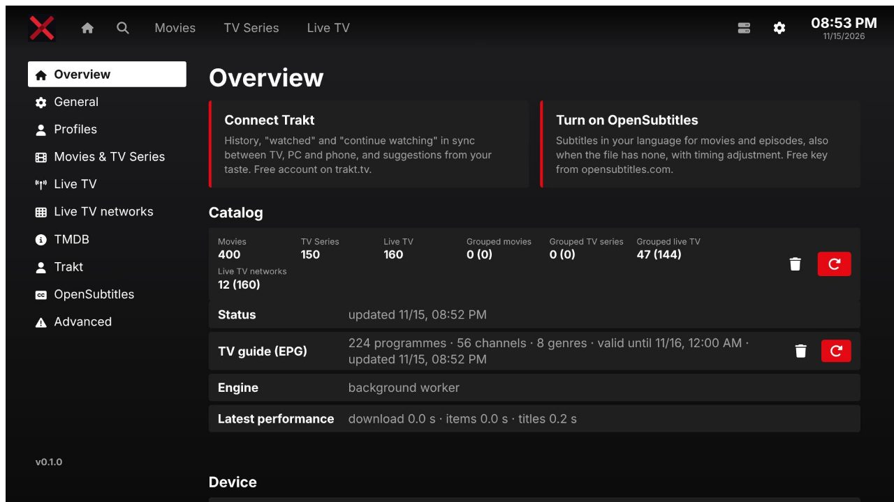
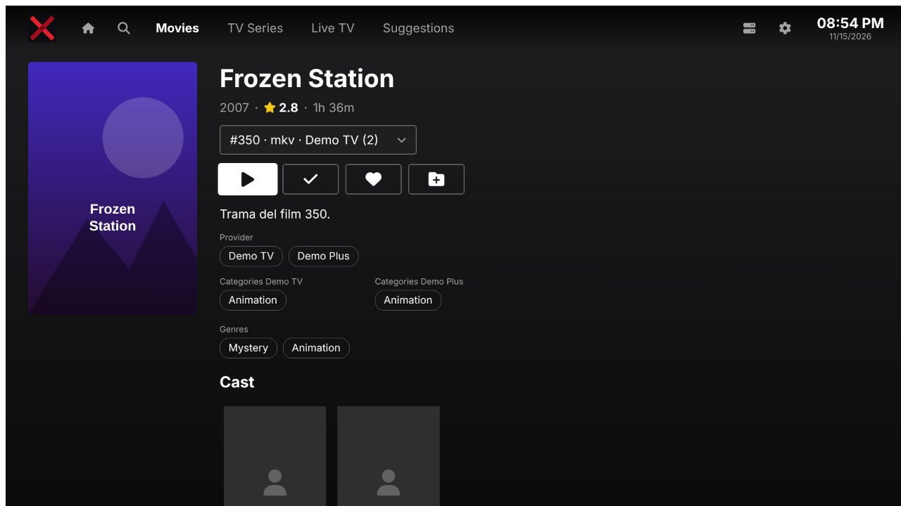
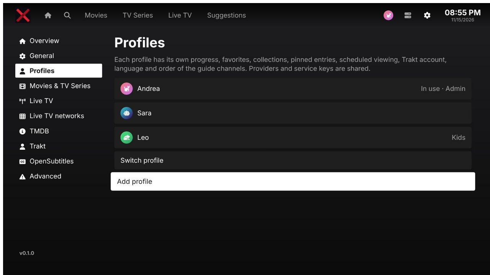
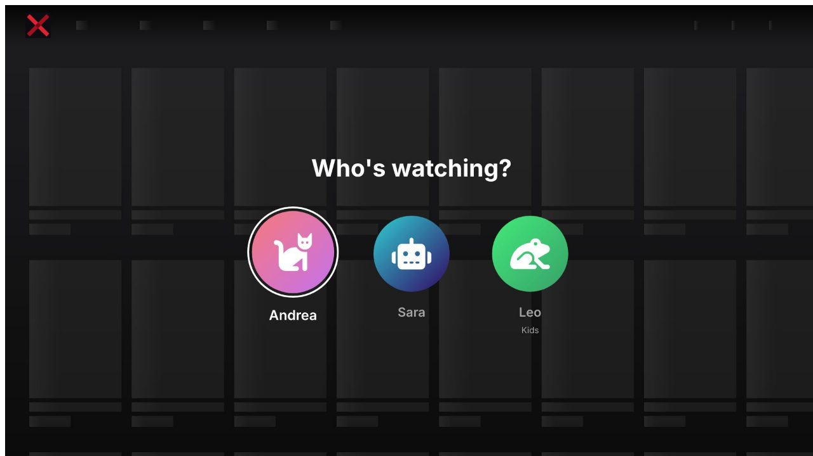

# Xtream IPTV

A fast, TV-first **Xtream Codes** client for **Samsung Tizen**, **LG webOS**, **Android TV / Fire TV** and **Windows, macOS and Linux**.
Browse your provider's movies, series and live channels with the remote control, pick up where you left off, and watch trailers,
cast and guides in a clean interface designed for a 1920x1080 screen. One app, the same on every platform.

> This project does not provide, host or link to any content. You need your own IPTV provider: an Xtream Codes account or an M3U playlist
> (or several: they can be used together, as one catalog).

> **For the best experience, set up TMDB, Trakt and OpenSubtitles** (all free, see [Optional services](#optional-services)): posters,
> plots, cast and trailers, watch history on every device, and subtitles for any title.

## Platforms

Every release on the [Releases](../../releases) page has one package per platform, named `xtream-iptv-<version>_<platform>.<ext>`
(with a `.sha256` checksum).

| Platform | Package | Install guide |
|---|---|---|
| Samsung Tizen TV (6.0 or newer) | `_tizen.wgt` (store build), `_tizen_youtube.wgt` (trailers in the app), and both with `_autoupdate` | [`platforms/tizen`](platforms/tizen/README.md) |
| LG webOS TV (6.0 or newer) | `_webos.ipk` (store build), `_webos_autoupdate.ipk` | [`platforms/webos`](platforms/webos/README.md) |
| Android TV / Google TV | `_androidtv.apk` | [`platforms/android`](platforms/android/README.md) |
| Amazon Fire TV (Fire OS models) | `_firetv.apk` | [`platforms/android`](platforms/android/README.md) |
| Windows, macOS, Linux | `_windows-x64.exe`, `_macos-x64.dmg`, `_macos-arm64.dmg`, `_linux-x64.AppImage`, `_linux-x64.deb` | [`platforms/desktop`](platforms/desktop/README.md) |

Tizen is developed and tried on a 2021 QLED and the Windows app is tried as well; webOS, Android TV / Fire TV, macOS and Linux are
still being tested on real devices.

## Features

Every feature below says **how it works**, what you can **set**, and what you **gain**. Settings are under **Settings** in the top
bar (the gear); "Settings → X" names the page of its sidebar.

### One catalog, several providers

- **How it works.** Add as many providers as you like on the **Provider** page (Xtream API, or an M3U playlist with its XMLTV guide)
  and switch on the ones you want. Their movies, series and channels form one catalog: the same title once (by TMDB id, otherwise by
  clean name and year across providers), its versions from every provider in the version dropdown of its page (each ending with the
  name of its provider), its categories grouped per provider ("Categories <provider>" in the sidebar and on the title page), the guides
  of all of them joined. With several providers active the info line of a title says which ones have it. Within one provider, titles
  are merged only when the provider itself gives them the same TMDB id (4K, HD and dubbed versions of the same film).
- **Settings.** The **Provider** page: a switch per provider, its table of lists (movies, series, channels, categories shown and in
  total, last update) with update and remove buttons. *Settings → Overview*: the table of the unified catalog (titles, grouped titles,
  networks) with rebuild and remove. **Visible categories** on the Provider page: hide the categories you never use.
- **What you gain.** One card per film instead of five copies; everything of every subscription in the same grids, search and guide;
  favourites, progress and collections that follow a title from one provider to another.

### Fast with huge catalogs

- **How it works.** The provider's lists are downloaded and worked out in a background worker (tens of thousands of titles), stored on
  the device and shown in grids that load as you scroll. At start the stored catalog is shown at once; lists older than 12 hours are
  refreshed in the background, only what changed is written. TMDB metadata, genres, age ratings and the people of the titles are found
  by background jobs too, at a pace the provider and TMDB accept, pausing while you browse.
- **Settings.** *Settings → Overview*: operations in progress (each can be stopped), the state of the catalog, rebuild or empty the
  derived data (no new download), the size on the device. *Settings → TMDB*: a row per background job (metadata, genres, ratings,
  people, title details) with update and remove.
- **What you gain.** No waiting at start, no freezing while the catalog updates, smooth grids even on old TVs.

### Clean titles, genres and categories

- **How it works.** Titles lose language prefixes, quality tags and year suffixes ("IT: Inception (2010) [4K]" → "Inception"). The genres
  of the provider and of TMDB are merged under one name; the sidebar of Movies and TV Series lists the genres, the categories (one block
  per provider) and the age ratings of the catalog. Any category, genre or guide genre can be pinned to the sidebar or added to the
  favourites with the buttons at the top of its grid.
- **Settings.** *Settings → Movies & TV Series*: clean titles on / off; **Visible categories** per provider on the Provider page.
- **What you gain.** Readable names, one "Drama" instead of four spellings, the sections you use always at hand.

### Age ratings

- **How it works.** Every film and series with TMDB metadata gets the age rating of your country (from the language of the app; "VM14"
  and "14+" count as the same age). The sidebar of Movies and TV Series has a **Rating** group after the categories (All ages, 6+, 14+…
  with their numbers); the rating on a title page is clickable and opens that group with its grid. The ratings are worked out in the
  background after the TMDB download, without any extra request.
- **Settings.** *Settings → TMDB → Rating*: how many titles have one, work them out again, delete them.
- **What you gain.** Find what suits a child or an evening in a moment; the same ratings drive the limits of the kids profiles.

### Search

- **How it works.** The magnifier in the top bar searches as you type: movies, series, channels, collections and the programmes on TV in
  the next 24 hours, in rows by type. The last searches are kept and offered when the field is empty.
- **Settings.** None.
- **What you gain.** One field for the whole catalog and the guide.

### Title pages

- **How it works.** Picture, title, an info line (the TMDB logo when TMDB enriched the page, year, rating, the providers that have it,
  duration or seasons), the action buttons (play, **Rewind** to bring the progress of a film or of a whole series back to the start, also
  on Trakt, watched, trailer, favourite, collection, and for admins the shield that marks a title as adult content or not), plot,
  categories, genres, age rating, director, production companies, episodes, cast and related titles. Director, cast and companies are
  clickable (see the next section). Trailers play in the app on Samsung TVs, in the YouTube app or the browser elsewhere.
- **Settings.** TMDB (see [Optional services](#optional-services)) adds pictures, plots, cast, trailers and ratings.
- **What you gain.** Everything about a title on one page, and one press to reach the rest of the catalog from it.

### People and production companies

- **How it works.** The cast cards, the director and the production companies of a title page open a page laid out as a title page:
  photo or logo, roles (acting, directing, production…) or, for a company, how many of its films and series are in your catalog, birth
  and death with the age, the biography (a long one opens with "Show more" and scrolls with the arrows), a backdrop from one of their
  titles, and the carousels of their films and series in your catalog, with their role under each card. With TMDB the data comes from
  it by id; without TMDB the cast and director the provider names are found by name (production companies need TMDB). The heart puts a
  person or a company in the favourites: they are listed on the Favorites page, in "People" and "Production companies".
- **Settings.** *Settings → TMDB → People*: without TMDB, the search of the cast and directors in the provider's details (every title
  asked once, at the provider's pace), with update and remove.
- **What you gain.** "What else is there with this actor?" answered from your own catalog.

### Player

- **How it works.** The native engine of each platform (AVPlay on Tizen, the system player on webOS, ExoPlayer on Android and Fire TV,
  the browser engine on desktop). A progress bar you can drag or move with the arrows (the jump happens when you stop), previous / next
  episode, an end-credits point set once per series (the next episode is offered from there, otherwise 10 seconds before the end),
  aspect ratio, audio tracks (the one in the language of the app is chosen by itself), resume where you left off and autoplay of the
  next episode. Leaving the app and coming back keeps the player as it was, paused or playing.
- **Settings.** *Settings → General*: buffering. *Settings → Movies & TV Series*: autoplay next episode.
- **What you gain.** A player that behaves the same on every device and remembers where you were.

### Subtitles

- **How it works.** The **Subtitles** button lists the tracks of the player and, on MKV and MP4 files whose tracks the TV does not show,
  the text tracks read by the app itself. With OpenSubtitles set up, **Download from OpenSubtitles** finds subtitles in your language
  (then English) for movies and episodes with a TMDB id — the one the title page found, also by TMDB's search — sending the file's hash
  so that subtitles made for that very file come first.
  **Alignment of the downloaded subtitles** fixes subtitles that are early, late or drift: a guided procedure over the player with two
  bars above the progress bar, zoomed on two minutes, one with the lines of the subtitles and one with the video. Choose a line with
  Left / Right and OK; on the video bar move the green anchor (faster while the arrow is held) to the moment the line is spoken and press
  OK to play video and subtitles together and check; then "Add point". From two points (about ten minutes apart, which the procedure
  suggests) both the delay and the speed are corrected, which also fixes subtitles made for a 25 fps release. The points are saved for
  that video and file, the alignment is used again whenever the same subtitles are downloaded, and the list says "(done)".
- **Settings.** *Settings → OpenSubtitles*: the API key (see [Optional services](#optional-services)).
- **What you gain.** Subtitles for almost anything, in time with the voice, aligned once for good.

### Live TV

- **How it works.** The programme on air on every channel card, the next 24 hours on the channel page. Channels in several qualities are
  grouped into one card (the best version plays, the others in the dropdown), the channels of a broadcaster (Rai, Sky, Dazn…) are
  collected in a network. A live channel can be paused: play goes on from where you stopped, **Back to live** jumps to now. Channel up /
  down switch channel in the player.
- **Settings.** *Settings → Live TV*: group identical channels, words to remove from channel names before comparing them, custom EPG.
  *Settings → Live TV networks*: build networks, similarity of the names, characters of difference, numbers left out.
  On a channel page: merge it by hand with another channel, add it to a network.
- **What you gain.** One "Rai 1" instead of six, the channels of a broadcaster together, a pause button on live TV.

### TV guide (EPG)

- **How it works.** A full grid guide in Live TV (each programme shows its full title and times after a moment, OK opens its actions),
  the genres of the guide's categories (Sport, News, Movies…) in the sidebar, each opening the guide with only those programmes. The
  guide is downloaded once a day after the rest of the start-up, joining the guides of every active provider and, if you set one, a
  custom XMLTV guide; it is written in small steps so that the app stays responsive while it downloads. **Scheduled viewing** opens the
  channel when a programme starts, with an alert of the system when the app is in the background or closed (Android TV / Fire TV and
  desktop notifications; on Samsung TVs the app starts on the channel); scheduled programmes stay highlighted.
- **Settings.** *Settings → Live TV → Custom EPG*: the address of an XMLTV guide (see [Custom EPG](#custom-epg)). *Settings → Overview*:
  the guide's row with download again and delete. The rows of the guide can be hidden or moved (OK held on a row).
- **What you gain.** A real guide on any provider, never missing the start of a match.

### Home, favourites, collections and suggestions

- **How it works.** Home shows **Continue watching**, new movies, new series and suggestions (from what you watch, by TMDB or Trakt).
  **Favorites** collects titles, channels, categories, genres, people and production companies; **Collections** are lists you make of
  movies, series and channels; both, and the pins of the sidebar, follow a title across providers. The entries of the top bar
  (Favorites, Collections, Suggestions) appear only when they have something.
- **Settings.** *Settings → General → Suggestions source*: TMDB or Trakt.
- **What you gain.** What you care about one press away, the same on every provider.

### Profiles

- **How it works.** Until a second profile is made, nothing changes. With two or more, "Who's watching?" opens at every start (each
  profile can have an access PIN) and the avatar in the top bar switches profile. Each profile has its avatar (20 to choose from), its
  progress, favourites, collections, pins, scheduled viewing, Trakt account, language and guide order. Admin profiles see all the
  settings and manage the providers; the others see only their profile, language and Trakt account. **Kids profiles** never see adult
  content anywhere, and can have watching hours (no watching before / after a time), daily minutes of watching and a range of age ratings
  (titles and guide programmes outside it are hidden); leaving a kids profile takes the parental PIN of an adult profile.
- **Settings.** *Settings → Profiles*: add, edit (avatar, name, kids, admin, access PIN, the limits of a kids profile), switch, remove.
- **What you gain.** One TV for the whole family, each with their own history and recommendations, children kept to what suits them.

### Parental control

- **How it works.** A PIN protects adult content: titles the provider flags, titles in categories with an adult name, and titles an
  admin marked with the shield on their page (or unmarked, when the provider got it wrong). Their posters are hidden behind a lock and
  opening them asks for the PIN; kids profiles do not see them at all.
- **Settings.** *Settings → General → Parental control PIN*; the shield on a title page (admin profiles).
- **What you gain.** Adult content out of sight without hiding it from the adults.

### Trakt

- **How it works.** What you watch is saved on your Trakt account and read back: watched marks and continue watching follow you between
  the TV, the PC and the phone (and any other app that uses Trakt); suggestions can be based on your history. Every profile connects its
  own account with a QR code.
- **Settings.** *Settings → Trakt* (see [Optional services](#optional-services)): connect, sync now, remove; admins also see the keys and
  the table of what is aligned.
- **What you gain.** The same history everywhere, and an account that survives a reset of the TV.

### Look and language

- **How it works.** English and Italian, following the device or chosen per profile; text size; time and date formats; a screensaver
  with the logo after some minutes without a key (not while a video plays).
- **Settings.** *Settings → General*: language, text size, time format, date format, screensaver (off, 1, 5 or 15 minutes).
- **What you gain.** Readable from the sofa, in your language, no image burnt into the screen.

### Remote, mouse and touch

- **How it works.** Made for the remote (see [Remote control](#remote-control)); every page has the same rules: Up from the first row
  reaches the top bar, Down comes back, Right enters a grid from its sidebar and Left goes back to it. A mouse or a finger works too:
  hover focuses, click or tap activates, the wheel scrolls; icon buttons show their name after a moment. A button runs its action once at
  a time: a quick second press does not open the same list twice.
- **Settings.** None.
- **What you gain.** The same app on a TV, a PC or a touch screen.

### Private and up to date

- **How it works.** No account, no analytics: the keys stay on the device and are sent only to their own service, credentials are masked
  in the logs. The "_autoupdate" packages of Tizen and webOS download a newer build by themselves and offer to restart; the others are
  updated from the Releases page. *Settings → Advanced → Diagnostics* shows the log, with a QR code to send it.
- **Settings.** *Settings → Advanced*: check for updates (autoupdate packages), diagnostics, delete all data.
- **What you gain.** Nothing leaves the device but what a service needs; problems can be reported with the log in a moment.

## Compared with popular players

A quick look at three widely used IPTV players, from their public descriptions (November 2026; features change, check the official
store listings). "Not advertised" means we found no mention of it, not that it is missing.

| | **Xtream IPTV** | [TiviMate](https://tivimate.com) | [IPTV Smarters Pro](https://www.iptvsmarters.com) | IBO Player |
|---|---|---|---|---|
| Platforms | Tizen, webOS, Android TV / Fire TV, Windows, macOS, Linux | Android TV / Fire TV | Android, Fire TV, Samsung, LG, iOS and others | Android TV / Fire TV, Samsung, LG |
| Xtream Codes login, several providers | Yes, also active together as one catalog | Yes | Yes | Yes |
| Programme guide (EPG grid) | Yes, with a custom XMLTV guide | Yes (its strong point) | Yes | Yes |
| Catch-up / recording | No (catch-up planned) | Catch-up; recording with premium | Catch-up | Not advertised |
| Programmes in the search | Yes | Yes | Not advertised | Not advertised |
| Scheduled viewing (opens the channel when it starts) | Yes | Not advertised | Not advertised | Not advertised |
| Genres from the guide's categories | Yes | Not advertised | Not advertised | Not advertised |
| Quality variants of a channel grouped into one card | Yes, automatic, with manual links | Not advertised | Not advertised | Not advertised |
| TV networks (channels of the same broadcaster collected) | Yes, automatic, with manual links | Not advertised | Not advertised | Not advertised |
| Duplicate movies and series merged into one card | Yes (by TMDB id) | No | No | No |
| Clean titles (no language prefixes, quality tags) | Yes | Not advertised | Not advertised | Not advertised |
| Favourite and pinned categories, genres, networks | Yes | Favourite channels | Favourites | Favourites |
| Collections of movies, series and channels | Yes | Not advertised | Not advertised | Not advertised |
| Favourites, collections and pins shared between providers | Yes (by TMDB id) | Not advertised | Not advertised | Not advertised |
| End-credits point per series (next episode from there) | Yes | Not advertised | Not advertised | Not advertised |
| TMDB posters, plots, cast, trailers | Yes (own free key) | Not advertised | Partly (trailers, info) | Not advertised |
| Trakt history and progress sync | Yes | No | Not advertised | Not advertised |
| Subtitles from OpenSubtitles | Yes, by file hash, with a guided alignment (delay and speed) | Not advertised | Not advertised | Not advertised |
| Parental control | Yes (PIN, kids profiles) | Yes | Yes | Not advertised |
| Open source, no account, no analytics | Yes | No | No | No |

## Screenshots

| | |
|---|---|
|  **First run**: add your provider |  **Home**: new movies, new series, continue watching |
|  **Movies**: genres, categories and filters |  **TV series** |
|  **Live TV** with the programme now playing |  **Search** from the top bar |
|  **Movie**: play, trailer, watched, favorite |  **Series**: seasons and episodes |
|  **Player** |  **Settings**: catalog, guide, services, preferences |
|  **Providers**: two active, each with its lists |  **One catalog**: the providers of a title, its categories per provider, versions from both |
|  **Profiles** in Settings |  **A profile**: avatar, name, kids, admin, access PIN |
|  **Who's watching?** at start and when switching | |

The screenshots use the fictional demo catalog of the mock server (`npm run screenshots`).

## First steps

1. **Install the app** with the guide of your platform (see [Platforms](#platforms)).
2. **Add a provider**: choose **Xtream API** (server URL, username and password) or **M3U / XMLTV** (playlist URL and, optionally, its guide). The catalog downloads in the background.
3. **Recommended:** type the TMDB, Trakt and OpenSubtitles keys in **Settings** (see below).
4. **Optional:** add more providers from the **Provider** page (each one can be switched on or off; the active ones form one catalog),
   and profiles for the family in **Settings → Profiles**.

## Optional services

All three are free for personal use. The app works without them, but it is much better with them. Nothing is compiled into the
app: each service stays off until its key is typed in **Settings** (with a remote the on-screen keyboard works; on a phone it is
easier to copy the keys into a note first). The keys stay on the device and are sent only to their own service.

### TMDB: posters, plots, cast, trailers

Posters and backdrops, plots in your language, cast, genres, ratings, trailers and recommendations. The TMDB id also merges the same
title across categories and providers, so favorites, collections and pins follow you from one provider to another.

1. Create a free account on [themoviedb.org](https://www.themoviedb.org) and confirm the email.
2. Open *Profile → Settings → API* ([direct link](https://www.themoviedb.org/settings/api)) and request an API key (type *Developer*; a short description of a personal use is fine).
3. Copy the **API Read Access Token** (v4, the long one) or the 32-character **API Key** (v3) into *Settings → TMDB*.

### Trakt: watch history and progress on every device

What you watch is saved on your Trakt account and read back: *watched* marks and *continue watching* follow you between the TV, the
PC and the phone (and any other app that uses Trakt), and suggestions can be based on your history. *Settings → Trakt* shows how many
titles are aligned.

1. Create a free account on [trakt.tv](https://trakt.tv).
2. Open [trakt.tv/oauth/applications](https://trakt.tv/oauth/applications) and press **New Application**: any name, `urn:ietf:wg:oauth:2.0:oob` as *Redirect uri*, the rest empty.
3. Copy the **Client ID** and **Client Secret** into *Settings → Trakt*, press connect and scan the QR code (or open the address shown and type the code).

### OpenSubtitles: subtitles for any title

On a movie or episode with a TMDB id, the player's **Subtitles** list has a **Download from OpenSubtitles** entry: it downloads subtitles
in your language (then English), also when the file has its own, and the list then shows them as "OpenSubtitles: <language>" with an
**Alignment of the downloaded subtitles** entry (see [Subtitles](#subtitles)). They stay in memory until the app is closed; their
alignment is saved. The app sends the video's OpenSubtitles hash (it reads the first and last 64 KB), so subtitles made for that very
file come first ("for this file").

1. Create a free account on [opensubtitles.com](https://www.opensubtitles.com).
2. Create a consumer on [opensubtitles.com/consumers](https://www.opensubtitles.com/en/consumers) (any name): it gives an **API key**.
3. Type the key in *Settings → OpenSubtitles*.

Without logging in, OpenSubtitles allows a few downloads a day (5 at the time of writing): each new title uses one, the same title
again in the same session does not.

## Custom EPG

If your provider's guide is missing or poor, *Settings → Live TV → Custom EPG* accepts the address of an XMLTV guide (`http://` or
`https://`). It is saved only if it answers with a valid XMLTV file and joins the guides of the active providers: a programme found in
more than one is kept once (the custom guide's). Channels are matched by the provider's `epg_channel_id`, so the guide must use the
same ids. The field's "x" removes it.

## Remote control

| Key | Action |
|---|---|
| Arrows | Move the focus; Up from the first row of a page reaches the top bar, Down from the bar comes back; Right enters a grid from its sidebar, Left goes back |
| OK / Enter | Select (hold on a row of the guide for its actions) |
| Back | Go back / close (from a page's content: its sidebar, then the top bar) |
| Channel up / down | In the player: previous / next channel (live) or episode (series) |
| Play / pause on a live channel | Pauses it; play goes on from there, the **Back to live** button jumps to now |
| Play / pause / rewind / forward | In the player |
| Left / right in the player | Seek (after OK on the progress bar) |

The desktop app opens as a normal window (the player has a full-screen button) and the keyboard is the remote: arrows, `Enter`,
`Esc` / `Backspace` for Back, `PageUp` / `PageDown` for channel up / down, `Space` for play / pause.

## Documentation

| Document | Content |
|---|---|
| [`platforms/<name>/README.md`](platforms) | Installation and notes per platform: [Tizen](platforms/tizen/README.md), [webOS](platforms/webos/README.md), [Android TV / Fire TV](platforms/android/README.md), [desktop](platforms/desktop/README.md) |
| [`docs/BUILD.md`](docs/BUILD.md) | Building from source, running in a browser, packaging, tests, releases and signing, project layout |
| [`docs/MULTIPLATFORM.md`](docs/MULTIPLATFORM.md) | How the platforms share one app: the adapter, decisions, per-platform details and open issues |
| [`docs/DESIGN.md`](docs/DESIGN.md) | Design decisions; read before changing the code |
| [`docs/MILESTONES.md`](docs/MILESTONES.md) | Development history, with what has and has not been verified on a real device |
| [`docs/MOCK-TEST.md`](docs/MOCK-TEST.md) | The fake Xtream server and the performance measurements |

Plain HTML, JavaScript and SCSS (no UI framework), with an extensive unit test suite.

## License

No license has been chosen yet.

---

This repository, its commits and its releases are entirely managed by [Claude](https://claude.ai) (Anthropic).
