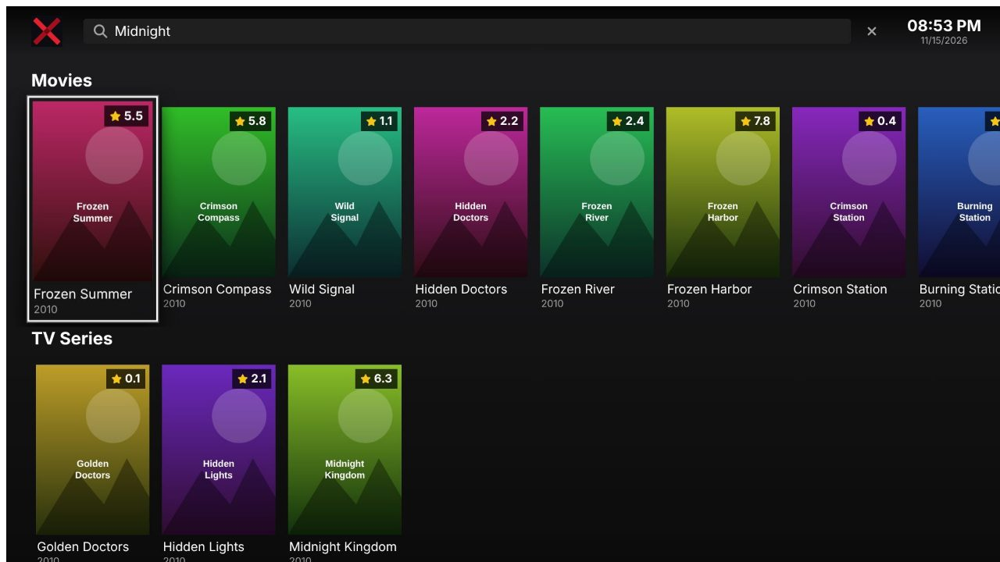
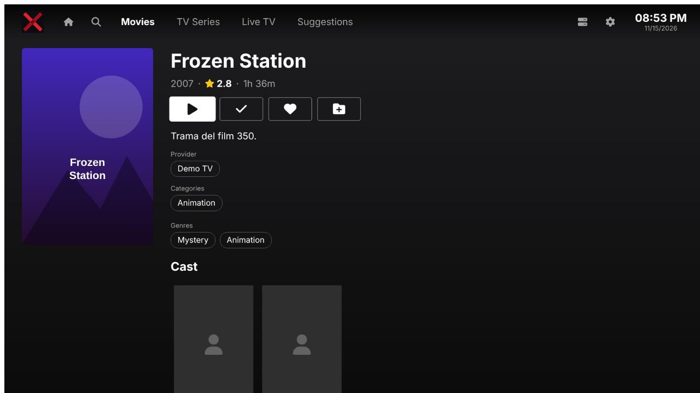
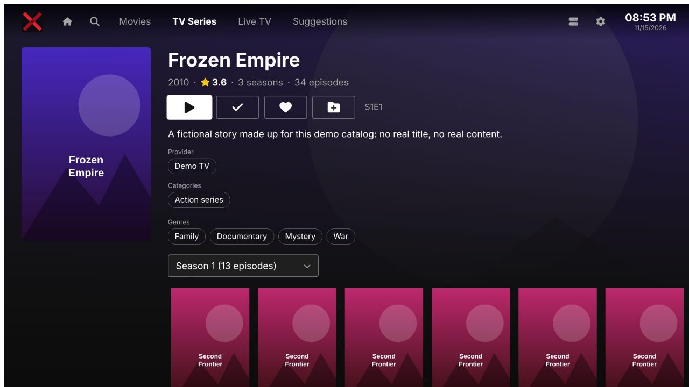
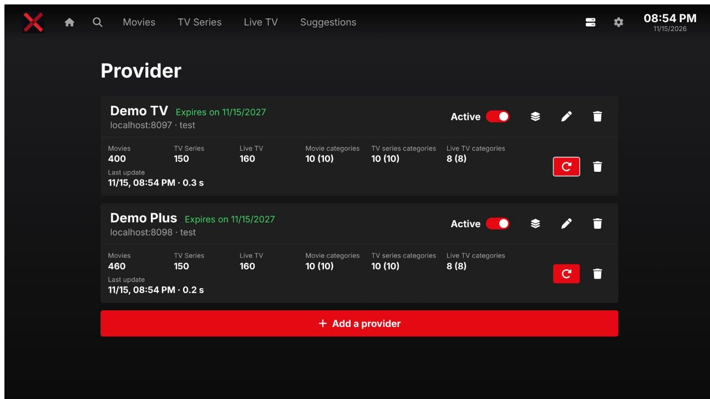
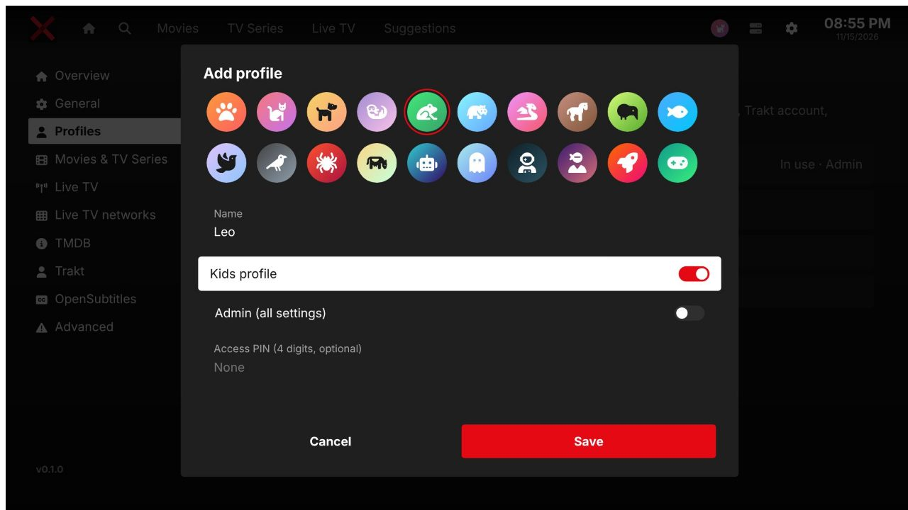

# Xtream IPTV

A fast, TV-first **Xtream Codes** client for **Samsung Tizen**, **LG webOS**, **Android TV / Fire TV** and **Windows, macOS and Linux**.
Browse your provider's movies, series and live channels with the remote control, pick up where you left off, and watch trailers,
cast and guides in a clean interface designed for a 1920x1080 screen. One app, the same on every platform.

> This project does not provide, host or link to any content. You need your own IPTV provider: an Xtream Codes account or an M3U playlist
> (or several: they can be used together, as one catalog).

> **For the best experience, set up TMDB, Trakt and OpenSubtitles** (all free, see [Optional services](#optional-services)): posters,
> plots, cast and trailers, watch history on every device, and subtitles for any title.

## Contents

- [Platforms](#platforms)
- [First steps](#first-steps)
- [Features](#features)
  - [One catalog, several providers](#one-catalog-several-providers) · [Fast with huge catalogs](#fast-with-huge-catalogs) · [Player](#player) · [Sync between TVs](#sync-between-tvs) · [TV guide (EPG)](#tv-guide-epg) · [Live TV](#live-tv) · [Home, favourites, collections and suggestions](#home-favourites-collections-and-suggestions) · [Title pages](#title-pages) · [Search](#search) · [Subtitles](#subtitles) · [Profiles](#profiles) · [Trakt](#trakt) · [Private and up to date](#private-and-up-to-date) · [Parental control](#parental-control) · [Clean titles, genres and categories](#clean-titles-genres-and-categories) · [Remote, mouse and touch](#remote-mouse-and-touch) · [Age ratings](#age-ratings) · [People and production companies](#people-and-production-companies) · [Look and language](#look-and-language)
- [Optional services](#optional-services)
- [Compared with popular players](#compared-with-popular-players)
- [Screenshots](#screenshots)
- [Remote control](#remote-control)
- [Custom EPG](#custom-epg)
- [Documentation](#documentation)
- [License](#license)

## Platforms

Every release on the [Releases](../../releases) page has one package per platform, named `xtream-iptv-<version>_<platform>.<ext>`
(with a `.sha256` checksum).

| Platform | Package | Install guide |
|---|---|---|
| Samsung Tizen TV (6.0 or newer) | `_tizen.wgt` (store build), `_tizen_youtube.wgt` (trailers in the app), and both with `_autoupdate` | [`platforms/tizen`](platforms/tizen/README.md) |
| LG webOS TV (6.0 or newer) | `_webos.ipk` (store build), `_webos_autoupdate.ipk` | [`platforms/webos`](platforms/webos/README.md) |
| Android TV / Google TV | `_androidtv.apk` | [`platforms/android`](platforms/android/README.md) |
| Amazon Fire TV (Fire OS models) | `_firetv.apk` | [`platforms/android`](platforms/android/README.md) |
| Windows, macOS, Linux | `_windows-x64.exe`, `_macos-x64.dmg`, `_macos-arm64.dmg`, `_linux-x64.AppImage`, `_linux-x64.deb` | [`platforms/desktop`](platforms/desktop/README.md) |

Tizen is developed and tried on a 2021 QLED and the Windows app is tried as well; webOS, Android TV / Fire TV, macOS and Linux are
still being tested on real devices.

## First steps

1. **Install the app** with the guide of your platform (see [Platforms](#platforms)).
2. **Add a provider**: choose **Xtream API** (server URL, username and password) or **M3U / XMLTV** (playlist URL and, optionally, its guide). The catalog downloads in the background.
3. **Recommended:** type the TMDB, Trakt and OpenSubtitles keys in **Settings** (see below).
4. **Optional:** add more providers from the **Provider** page (each one can be switched on or off; the active ones form one catalog),
   and profiles for the family in **Settings → Profiles**.

## Features

Sorted by impact: how much each feature adds to watching IPTV on a TV. Settings are under **Settings** (the gear in the top bar).

### One catalog, several providers

*Impact 9/10*

Add any number of providers (Xtream API, or M3U with its XMLTV guide) and switch on the ones you want: their movies, series and
channels become **one catalog**. The same title appears once (by TMDB id, otherwise by clean name and year), with the versions of every
provider in its dropdown, its categories grouped per provider and all the guides joined. One card per film instead of five copies, and
favourites, progress and collections that follow a title from one provider to another.

**Settings:** the **Provider** page (a switch per provider, its lists, visible categories); *Settings → Overview* (the unified catalog).

### Fast with huge catalogs

*Impact 9/10*

Tens of thousands of titles are downloaded and worked out in background workers and stored on the device. The stored catalog shows at
once at start, lists older than 12 hours refresh in the background (only what changed is written), and grids load as you scroll. TMDB
metadata, genres, ratings and people are found by background jobs that pause while you browse. No waiting, no freezing, smooth grids on
old TVs.

**Settings:** *Settings → Overview* (operations in progress, catalog state, rebuild, size); *Settings → TMDB* (one row per background job).

### Player

*Impact 9/10*

The native engine of each platform (AVPlay on Tizen, the system player on webOS, ExoPlayer on Android / Fire TV, the browser on
desktop): a progress bar to drag or move with the arrows, previous / next episode, an end-credits point per series, aspect ratio, audio
tracks (the one in your language picked by itself), resume where you left off and autoplay of the next episode.

**Settings:** *Settings → General* (buffering); *Settings → Movies & TV Series* (autoplay).

### Sync between TVs

*Impact 8/10*

Two or more TVs with the same account stay the same: providers, settings, profiles (with the kids limits and their minutes added up),
keys, Trakt account, watch state, favourites, collections, pinned entries and subtitle alignments. Changes are sent a minute after the
start, every 10 minutes and when the app goes to the background; the other TVs take them at their next start, or at once with *Sync now*.
Not synced: the parental PINs, scheduled viewing, the settings of each TV (text size, screensaver, buffer). A second TV is ready in a
minute, and the data survives a reset.

- **Encryption:** everything is encrypted on the TV before it leaves; the password never leaves it. PBKDF2-SHA-256 (100,000 iterations)
  gives a master key and three keys from it (encrypt, name the items, sign the writes); every item is sealed on its own with AES-256-GCM
  (a new random IV each time).
- **Server:** one file per account, named after a SHA-256 of the username, with ids that say nothing and cipher text only, in the public
  repository [andreadegiovinebk/xtream-iptv-client-bk](https://github.com/andreadegiovinebk/xtream-iptv-client-bk). Its workflow
  accepts a change only with the account's write key (5 wrong attempts lock the writes for the day) and deletes accounts unused for
  30 days. Details and how to make a new repository: [docs/SYNC_REPO.md](docs/SYNC_REPO.md).

**Settings:** *Settings → Sync* (username and password, at least 12 characters; then the account, the counts, show password, sync now,
remove). At the first start of a new TV, **Account** takes everything from an existing account.

### TV guide (EPG)

*Impact 8/10*

A full grid guide in Live TV joining the guides of every active provider and, if you set one, a custom XMLTV guide; the guide's genres
(Sport, News…) in the sidebar. **Scheduled viewing** opens the channel when a programme starts, with a system alert when the app is in
the background or closed. A real guide on any provider, never missing the start of a match.

**Settings:** *Settings → Live TV → Custom EPG* (see [Custom EPG](#custom-epg)); *Settings → Overview* (download again, delete); OK held on
a guide row hides or moves it.

### Live TV

*Impact 8/10*

The programme on air on every channel card and the next 24 hours on its page. Channels in several qualities are grouped into one card,
the channels of a broadcaster (Rai, Sky, Dazn…) collected in a network. Live TV can be paused (**Back to live** jumps to now); channel up
/ down switch channel in the player.

**Settings:** *Settings → Live TV* (group identical channels, words to ignore); *Settings → Live TV networks*; on a channel page, merge it
by hand or add it to a network.

### Home, favourites, collections and suggestions

*Impact 8/10*

Home shows **Continue watching**, new movies, new series and suggestions (by TMDB or Trakt). **Favorites** keeps titles, channels,
categories, genres, people and companies; **Collections** are your own lists of movies, series and channels. Both follow a title across
providers; Favorites, Collections and Suggestions appear in the top bar only when they have something.

**Settings:** *Settings → General → Suggestions source*.

### Title pages

*Impact 8/10*

Picture, an info line (TMDB logo, year, rating, providers, duration or seasons), the actions (play, **Rewind** to restart a film or a
whole series, watched, trailer, favourite, collection, the adult shield for admins), plot, categories, genres, age rating, director,
companies, episodes, cast and related titles. Trailers play in the app on Samsung TVs, in YouTube elsewhere.

**Settings:** TMDB (see [Optional services](#optional-services)) adds pictures, plots, cast, trailers and ratings.

### Search

*Impact 7/10*

The magnifier in the top bar searches as you type: movies, series, channels, collections and the programmes of the next 24 hours, in
rows by type; the last searches are offered when the field is empty.

**Settings:** none.

### Subtitles

*Impact 7/10*

The player's tracks, the text tracks of MKV / MP4 files the TV does not show, and **Download from OpenSubtitles** (your language, then
English), sending the file's hash so that subtitles made for that very file come first. **Alignment** fixes subtitles that are early,
late or drift: pick a line, move the green anchor to where it is spoken, add two points about ten minutes apart, and delay and speed are
corrected (also 25 fps subtitles). Saved for that file and used again every time.

**Settings:** *Settings → OpenSubtitles* (see [Optional services](#optional-services)).

### Profiles

*Impact 7/10*

With two or more profiles "Who's watching?" opens at start (each can have an access PIN). Each profile has its avatar, progress,
favourites, collections, pins, scheduled viewing, Trakt account, language and guide order; admins see all the settings. **Kids
profiles** never see adult content and can have watching hours, daily minutes and a range of age ratings.

**Settings:** *Settings → Profiles*.

### Trakt

*Impact 7/10*

What you watch is saved on your Trakt account and read back: watched marks and continue watching follow you on the TV, the PC and
the phone, and suggestions can come from your history. Every profile connects its own account with a QR code.

**Settings:** *Settings → Trakt* (see [Optional services](#optional-services)).

### Private and up to date

*Impact 7/10*

No analytics and no account required: keys stay on the device and go only to their own service, credentials are masked in the logs.
The "_autoupdate" packages download a newer build by themselves, keep it on the device (two slots, every file checked) and go back to
the previous version if the new one does not start; a failed start shows the error, the log and an update check.

**Settings:** *Settings → Advanced* (check for updates, diagnostics with a log QR code, delete all data).

### Parental control

*Impact 6/10*

A PIN protects adult content: titles the provider flags, categories with an adult name, and titles an admin marked with the shield.
Their posters are locked and opening them asks for the PIN; kids profiles do not see them at all.

**Settings:** *Settings → General → Parental control PIN*; the shield on a title page (admins).

### Clean titles, genres and categories

*Impact 6/10*

Titles lose language prefixes, quality tags and years ("IT: Inception (2010) [4K]" → "Inception"); provider and TMDB genres are merged
under one name. Any category, genre or guide genre can be pinned to the sidebar or added to the favourites.

**Settings:** *Settings → Movies & TV Series* (clean titles); visible categories on the Provider page.

### Remote, mouse and touch

*Impact 6/10*

Made for the remote with the same rules on every page (see [Remote control](#remote-control)); a mouse or a finger works too (hover
focuses, click or tap activates, the wheel scrolls), and a button never runs twice on a quick double press.

**Settings:** none.

### Age ratings

*Impact 5/10*

Every title with TMDB metadata gets the age rating of your country; the sidebar of Movies and TV Series has a **Rating** group (All
ages, 6+, 14+…) and the rating on a title page opens it. The same ratings drive the limits of the kids profiles.

**Settings:** *Settings → TMDB → Rating*.

### People and production companies

*Impact 5/10*

Cast, director and companies on a title page open their own page: photo or logo, roles, biography, and their films and series in
your catalog; the heart adds them to the favourites. "What else is there with this actor?", answered from your own catalog.

**Settings:** *Settings → TMDB → People* (without TMDB, cast and directors found by name).

### Look and language

*Impact 4/10*

English and Italian (from the device or per profile), text size, time and date formats, and a screensaver with the logo after some
minutes without a key.

**Settings:** *Settings → General*.

## Optional services

All three are free for personal use. The app works without them, but it is much better with them. Nothing is compiled into the
app: each service stays off until its key is typed in **Settings** (with a remote the on-screen keyboard works; on a phone it is
easier to copy the keys into a note first). The keys stay on the device and are sent only to their own service.

### TMDB: posters, plots, cast, trailers

Posters and backdrops, plots in your language, cast, genres, ratings, trailers and recommendations. The TMDB id also merges the same
title across categories and providers, so favorites, collections and pins follow you from one provider to another.

1. Create a free account on [themoviedb.org](https://www.themoviedb.org) and confirm the email.
2. Open *Profile → Settings → API* ([direct link](https://www.themoviedb.org/settings/api)) and request an API key (type *Developer*; a short description of a personal use is fine).
3. Copy the **API Read Access Token** (v4, the long one) or the 32-character **API Key** (v3) into *Settings → TMDB*.

### Trakt: watch history and progress on every device

What you watch is saved on your Trakt account and read back: *watched* marks and *continue watching* follow you between the TV, the
PC and the phone (and any other app that uses Trakt), and suggestions can be based on your history. *Settings → Trakt* shows how many
titles are aligned.

1. Create a free account on [trakt.tv](https://trakt.tv).
2. Open [trakt.tv/oauth/applications](https://trakt.tv/oauth/applications) and press **New Application**: any name, `urn:ietf:wg:oauth:2.0:oob` as *Redirect uri*, the rest empty.
3. Copy the **Client ID** and **Client Secret** into *Settings → Trakt*, press connect and scan the QR code (or open the address shown and type the code).

### OpenSubtitles: subtitles for any title

On a movie or episode with a TMDB id, the player's **Subtitles** list has a **Download from OpenSubtitles** entry: it downloads subtitles
in your language (then English), also when the file has its own, and the list then shows them as "OpenSubtitles: <language>" with an
**Alignment of the downloaded subtitles** entry (see [Subtitles](#subtitles)). They stay in memory until the app is closed; their
alignment is saved. The app sends the video's OpenSubtitles hash (it reads the first and last 64 KB), so subtitles made for that very
file come first ("for this file").

1. Create a free account on [opensubtitles.com](https://www.opensubtitles.com).
2. Create a consumer on [opensubtitles.com/consumers](https://www.opensubtitles.com/en/consumers) (any name): it gives an **API key**.
3. Type the key in *Settings → OpenSubtitles*.

Without logging in, OpenSubtitles allows a few downloads a day (5 at the time of writing): each new title uses one, the same title
again in the same session does not.

## Compared with popular players

A quick look at three widely used IPTV players, from their public descriptions (November 2026; features change, check the official
store listings). ✅ yes · ❌ no · ⚠️ partly · ❓ not advertised (we found no mention of it, which does not mean it is missing).

| |  **Xtream IPTV** |  [TiviMate](https://tivimate.com) |  [IPTV Smarters Pro](https://www.iptvsmarters.com) |  IBO Player |
|---|---|---|---|---|
| Platforms | Tizen, webOS, Android TV / Fire TV, Windows, macOS, Linux | Android TV / Fire TV | Android, Fire TV, Samsung, LG, iOS and others | Android TV / Fire TV, Samsung, LG |
| Xtream Codes login, several providers | ✅ also active together as one catalog | ✅ | ✅ | ✅ |
| Programme guide (EPG grid) | ✅ with a custom XMLTV guide | ✅ (its strong point) | ✅ | ✅ |
| Catch-up / recording | ❌ (catch-up planned) | ✅ catch-up; recording with premium | ✅ catch-up | ❓ |
| Programmes in the search | ✅ | ✅ | ❓ | ❓ |
| Scheduled viewing (opens the channel when it starts) | ✅ | ❓ | ❓ | ❓ |
| Genres from the guide's categories | ✅ | ❓ | ❓ | ❓ |
| Quality variants of a channel grouped into one card | ✅ automatic, with manual links | ❓ | ❓ | ❓ |
| TV networks (channels of the same broadcaster collected) | ✅ automatic, with manual links | ❓ | ❓ | ❓ |
| Duplicate movies and series merged into one card | ✅ (by TMDB id) | ❌ | ❌ | ❌ |
| Clean titles (no language prefixes, quality tags) | ✅ | ❓ | ❓ | ❓ |
| Favourite and pinned categories, genres, networks | ✅ | ⚠️ favourite channels only | ⚠️ favourites only | ⚠️ favourites only |
| Collections of movies, series and channels | ✅ | ❓ | ❓ | ❓ |
| Favourites, collections and pins shared between providers | ✅ (by TMDB id) | ❓ | ❓ | ❓ |
| End-credits point per series (next episode from there) | ✅ | ❓ | ❓ | ❓ |
| TMDB posters, plots, cast, trailers | ✅ (own free key) | ❓ | ⚠️ partly (trailers, info) | ❓ |
| Trakt history and progress sync | ✅ | ❌ | ❓ | ❓ |
| Subtitles from OpenSubtitles | ✅ by file hash, with a guided alignment (delay and speed) | ❓ | ❓ | ❓ |
| Sync between TVs (providers, settings, profiles, favourites, watch state) | ✅ automatic, encrypted on the TV | ⚠️ backup and restore by hand | ❓ | ❓ |
| Parental control | ✅ (PIN, kids profiles) | ✅ | ✅ | ❓ |
| Open source, no analytics, no account required | ✅ | ❌ | ❌ | ❌ |

## Screenshots

| | |
|---|---|
|  **First run**: add your provider |  **Home**: new movies, new series, continue watching |
|  **Movies**: genres, categories and filters |  **TV series** |
|  **Live TV** with the programme now playing |  **Search** from the top bar |
|  **Movie**: play, trailer, watched, favorite |  **Series**: seasons and episodes |
|  **Player** |  **Settings**: catalog, guide, services, preferences |
|  **Providers**: two active, each with its lists |  **One catalog**: the providers of a title, its categories per provider, versions from both |
|  **Profiles** in Settings |  **A profile**: avatar, name, kids, admin, access PIN |
|  **Who's watching?** at start and when switching | |

The screenshots use the fictional demo catalog of the mock server (`npm run screenshots`).

## Remote control

| Key | Action |
|---|---|
| Arrows | Move the focus; Up from the first row of a page reaches the top bar, Down from the bar comes back; Right enters a grid from its sidebar, Left goes back |
| OK / Enter | Select (hold on a row of the guide for its actions) |
| Back | Go back / close (from a page's content: its sidebar, then the top bar) |
| Channel up / down | In the player: previous / next channel (live) or episode (series) |
| Play / pause on a live channel | Pauses it; play goes on from there, the **Back to live** button jumps to now |
| Play / pause / rewind / forward | In the player |
| Left / right in the player | Seek (after OK on the progress bar) |

The desktop app opens as a normal window (the player has a full-screen button) and the keyboard is the remote: arrows, `Enter`,
`Esc` / `Backspace` for Back, `PageUp` / `PageDown` for channel up / down, `Space` for play / pause.

## Custom EPG

If your provider's guide is missing or poor, *Settings → Live TV → Custom EPG* accepts the address of an XMLTV guide (`http://` or
`https://`). It is saved only if it answers with a valid XMLTV file and joins the guides of the active providers: a programme found in
more than one is kept once (the custom guide's). Channels are matched by the provider's `epg_channel_id`, so the guide must use the
same ids. The field's "x" removes it.

## Documentation

| Document | Content |
|---|---|
| [`platforms/<name>/README.md`](platforms) | Installation and notes per platform: [Tizen](platforms/tizen/README.md), [webOS](platforms/webos/README.md), [Android TV / Fire TV](platforms/android/README.md), [desktop](platforms/desktop/README.md) |
| [`docs/BUILD.md`](docs/BUILD.md) | Building from source, running in a browser, packaging, tests, releases and signing, project layout |
| [`docs/MULTIPLATFORM.md`](docs/MULTIPLATFORM.md) | How the platforms share one app: the adapter, decisions, per-platform details and open issues |
| [`docs/DESIGN.md`](docs/DESIGN.md) | Design decisions; read before changing the code |
| [`docs/MILESTONES.md`](docs/MILESTONES.md) | Development history, with what has and has not been verified on a real device |
| [`docs/MOCK-TEST.md`](docs/MOCK-TEST.md) | The fake Xtream server and the performance measurements |
| [`docs/SYNC_REPO.md`](docs/SYNC_REPO.md) | The repository of the device sync: how it works and how to make a new one |

Plain HTML, JavaScript and SCSS (no UI framework), with an extensive unit test suite.

## License

No license has been chosen yet.

---

This repository, its commits and its releases are entirely managed by [Claude](https://claude.ai) (Anthropic).
